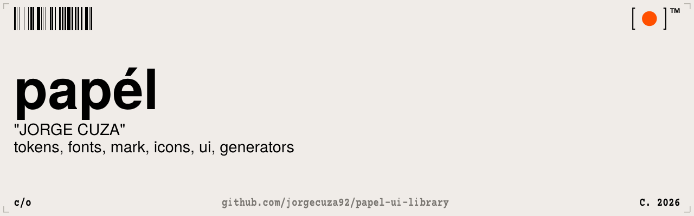
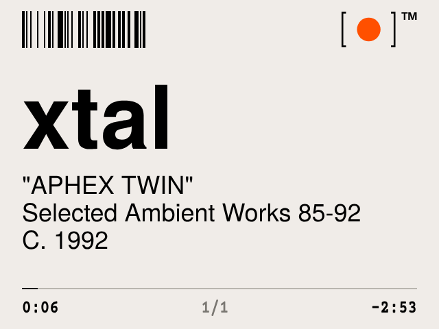
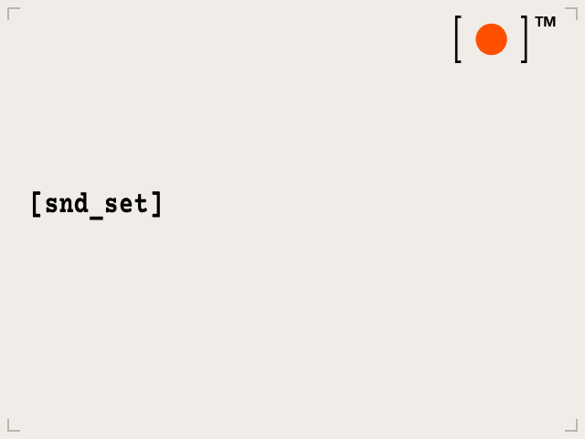
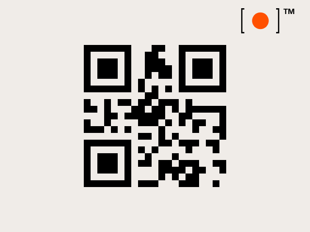
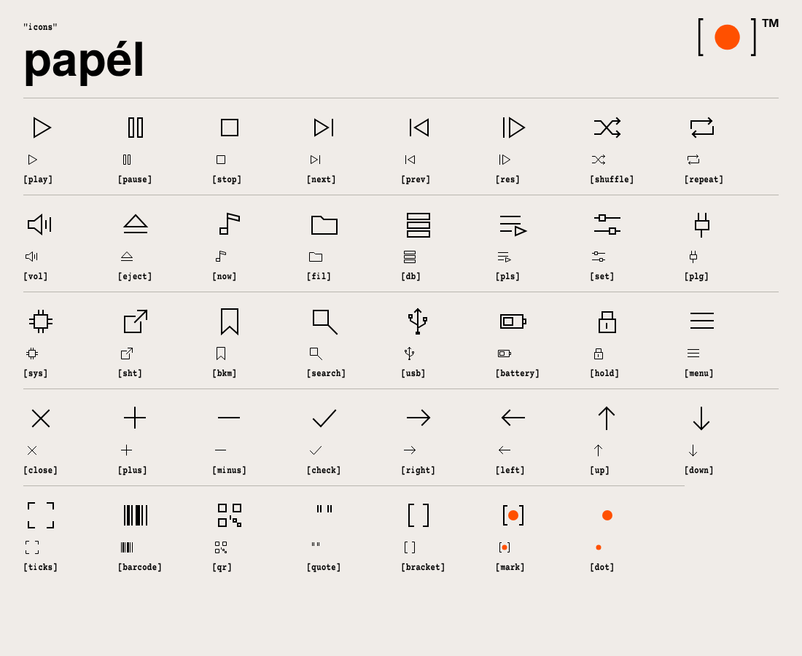

# papél ui library

`[●]™` "papél" c/o jorge cuza.

A small brand library: off-white paper, black type, one orange dot. It has tokens, fonts, the mark, an icon set, framework-free UI pieces, and generators for real barcodes and QR codes. Use any of it, anywhere, **as long as you give credit** ([CREDITS.md](CREDITS.md)).

The first thing built with it is an iPod Video theme: [**papel**](https://github.com/jorgecuza92/papel).

| player | menu | plug-in |
|---|---|---|
|  |  |  |

## "inside"

| folder | what |
|---|---|
| [`tokens/`](tokens) | `tokens.json`, the one source for colour, type, spacing and radius. `build.py` writes `dist/tokens.css`, `dist/tokens.js` and `dist/tailwind.preset.js`. |
| [`fonts/`](fonts) | TeX Gyre Heros (free Helvetica clone) and Courier Prime Papel (condensed typewriter). |
| [`mark/`](mark) | `[●]™` as a pixel-exact PNG (1x to 8x) and an SVG. |
| [`icons/`](icons) | 39 icons on a 24px grid with 1px hairline strokes: `svg/`, `sprite.svg`, and a preview sheet in `index.html`. |
| [`ui/`](ui) | `papel.css`: the mark slot, `"label"`, `[menu_item]`, title, info lines, `"NAME"`, `C. year`, hairline progress, corner ticks. `examples/` has three screens built with it. |
| [`generators/`](generators) | `code128.py` (barcodes), `qr.py` (QR codes), `paper.py` (recolours dark images to the palette). |
| [`docs/brand.md`](docs/brand.md) | The rules: mark, colour, type, voice, layout, ornaments, don'ts. |



## "use"

```html
<link rel="stylesheet" href="tokens/dist/tokens.css">
<link rel="stylesheet" href="ui/papel.css">

<section class="papel papel-sheet" style="--papel-scale:2">
  <div class="papel-ornament"></div>
  <div class="papel-mark"></div>
  <div class="papel-column">
    <p class="papel-title">Xtal</p>
    <div class="papel-info">
      <span class="papel-name">Aphex Twin</span>
      <span>Selected Ambient Works 85-92</span>
      <span class="papel-year">1992</span>
    </div>
  </div>
  <div class="papel-progress" style="--value:.3"></div>
  <div class="papel-times"><span>0:06</span><span class="papel-quiet">1/1</span><span>-2:53</span></div>
</section>
```

Icons work as plain `` tags or through the sprite (served over http):

```html
<svg class="papel-icon"><use href="icons/sprite.svg#papel-play"/></svg>
```

Tailwind users can add the preset instead:

```js
// tailwind.config.js
module.exports = { presets: [require('./tokens/dist/tailwind.preset.js')] }
// bg-papel-paper text-papel-ink font-sans text-papel-title
```

Generate ornaments:

```sh
pip install -r generators/requirements.txt
python3 generators/code128.py dobby                    # dobby.svg, scannable Code 128
python3 generators/qr.py "eject safely" --module 7     # eject_safely.svg
python3 generators/paper.py dark.png paper.png         # recolour to the palette
```

## "rules"

The short version of [docs/brand.md](docs/brand.md):

- **paper** `#f0ece8`, **ink** `#000000`, **signal** `#ff5000` for the dot only.
- **lowercase** by default. `"NAMES"` in caps inside quotes. `[menu_items]` in brackets, with underscores joining words. Dates as `C. 1992`.
- **one left-aligned column**, hairlines only, square corners.
- **the mark** sits in one fixed spot, top right, on every screen. The ™ appears only beside the mark.
- **barcodes and QR codes are real** and scan, drawn on whole pixels.

## "credit"

> design: "papél" c/o Jorge Cuza: github.com/jorgecuza92/papel-ui-library

- Design assets: [CC BY 4.0](LICENSE).
- Code: [MIT](LICENSE-CODE).
- Fonts: their own licences ([fonts/README.md](fonts/README.md)).

Inspired by the catalogue and wall-text language of Virgil Abloh. papél is an independent personal project, not affiliated with him, his estate or any brand.
